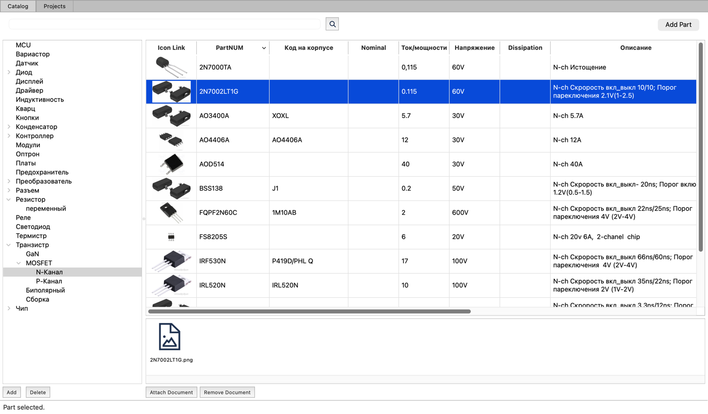
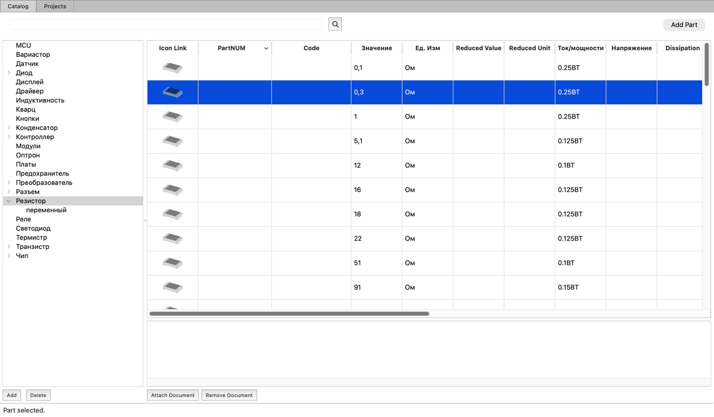

# PartsDB

[Русская версия](README.ru.md)

PartsDB (window title: *Electronic parts workbench*) is a small desktop application for cataloguing
electronic components and their datasheets. It is written in Python with PyQt6 and keeps everything
in a single SQLite file.



## Features

- **Section tree.** Parts are grouped into a tree of types and subtypes of any depth,
  for example `Транзистор / MOSFET / N-Канал` or `Диод / Шоттки`.
  Sections are added, renamed and deleted with the buttons under the tree and its context menu.
- **Parts table.** Selecting a section shows its parts in a table with a set of predefined fields
  (part number, body marking, value, units, current/power, voltage, package, description, quantity, in stock, …).
  Columns are configured per section: they can be renamed, hidden, shown again and aligned from the
  column header context menu or in **Setup → Edit headers**.
- **Part pictures.** The *Icon Link* column shows a picture of the part with a larger preview in the tooltip.
  Parts without their own picture get a default icon chosen by section and package (SMD or through-hole).
- **Search** across all parts from the search field above the table. A found part can be opened in its own section.
- **Adding, deleting and moving parts.** *Add Part* and the table context menu add and delete parts.
  Drag selected rows onto another section in the tree to move them there.
- **Documents.** Every part has a list of linked documents: datasheets, schematics, images, KiCad files or
  web links. Add them with *Attach Document* or by dragging a file from Finder or a URL from the browser onto
  the document area. Double-click opens a document in the application configured for its file extension
  (**Setup → Docs open exe**).
- **Several databases.** **File → Open DB** (`Ctrl+O`) and **File → Create new DB** (`Ctrl+N`).



## Installation

You need Python 3.11 or newer (the current build uses Python 3.14).

```bash
git clone https://github.com/abel-msk/PartsDB
```

```bash
cd PartsDB
```

A virtual environment is strongly recommended
(see https://docs.python.org/3/library/venv.html):

```bash
python3 -m venv venv
```

```bash
source venv/bin/activate
```

Install the dependencies:

```bash
pip install PyQt6 PyYAML pyinstaller
```

| Package      | Purpose                                                        |
|--------------|----------------------------------------------------------------|
| PyQt6        | GUI                                                            |
| PyYAML       | configuration file                                             |
| pyinstaller  | building the standalone application                            |
| openpyxl     | only for `ELImport.py` (one-off import from an Excel list)     |
| PySide6      | only for `updateui.sh` (it uses `pyside6-rcc` to compile resources) |

### Building the application

```bash
./build.sh
```

PyInstaller creates `dist/ElPartsDB` and, on macOS, `dist/ElPartsDB.app`.
Copy the `.app` to `/Applications`.

The application icon is `icons/ElPartsCatalog.icns`; the window icon is `icons/main1.png`.

## Running

```
ElPartsDB [-c CONFIG] [-d DBFILE] [-l LOGFILE] [-v]

  -c, --config   Path to the configuration file
  -d, --dbpath   Path to the SQLite database file
  -l, --logfile  Path to the log file. All stderr output is also copied there
  -v, --verbose  Debug-level logging. Without it only errors and critical messages are logged
```

### Configuration and data

- The installed application reads `~/.elworks/elworks.conf` (YAML). The folder is created on first start.
- `main.db_file` is the database. A relative path is resolved against `main.data_path`
  (by default the folder of the configuration file). Without `db_file` the application looks for
  `elworks.sqlite` in the data folder and in `~/.elworks`.
- Part pictures are stored in the icons folder inside the data folder. It is created if missing.
- `main.log_level` is `err` or `debug`, `main.log_file` is the log path (default `/tmp/elworks.log`).
- Window size and position and the applications used to open documents are saved to the same file on exit.

Example:

```yaml
main:
  data_path: ~/.elworks
  db_file: elworks.sqlite
  log_level: err
application_PDF_View:
  ext: pdf
  exec: /System/Applications/Preview.app
  args: '{file}'
```

## Development

Run from the sources:

```bash
python main.py -c tests/elworks.test.conf -v
```

When started from the sources without `-c`, the application uses `tests/elworks.test.conf`,
so it never touches the working database in `~/.elworks`. The test databases (`tests/*.sqlite`)
are not stored in git: put a copy of your database into `tests/` and point `db_file` in
`tests/elworks.test.conf` to it.

### Project layout

| File                                        | Contents                                                  |
|---------------------------------------------|-----------------------------------------------------------|
| `main.py`                                   | entry point: options, configuration, database, logging    |
| `ElMainWindow.py`                           | main window, menus, drag and drop                         |
| `ElTypesTree.py`                            | section tree                                              |
| `ElPartsTable.py`                           | parts table, column menus, search                         |
| `ElIconDelegate.py`, `ElDefaultIcons.py`    | part pictures in the table and default icons              |
| `ElIconListWidget.py`                       | list of part documents                                    |
| `ElDBScheme.py`                             | database schema and access (`DBFactory`, `Type`, `Part`, …) |
| `ElConfig.py`, `constants.py`               | configuration file and its keys                           |
| `ElAppList.py`, `ElAppPathDialog.py`, `ElProcess.py` | applications for opening documents               |
| `ElHdrEditDialog.py`                        | column header editor                                      |
| `ELImport.py`                               | import from an Excel list                                 |
| `qt/*.ui`, `qt/resources.qrc`               | Qt Designer forms and resources                           |

### Changing the UI

Forms are edited in Qt Designer (`qt/*.ui`). The generated files `ElParts.py`, `ElAppPathWnd.py`,
`ElOpenFileWnd.py`, `ElHdrEditWnd.py` and `resources.py` must not be edited by hand. Regenerate them:

```bash
./updateui.sh
```

### Tests

```bash
python -m unittest discover -s tests -v
```

The tests use the test database in `tests/` and the offscreen Qt platform.
