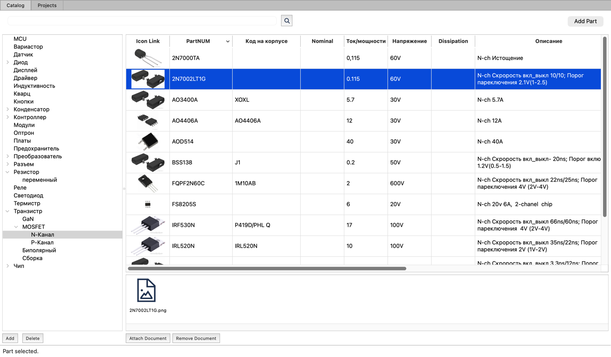
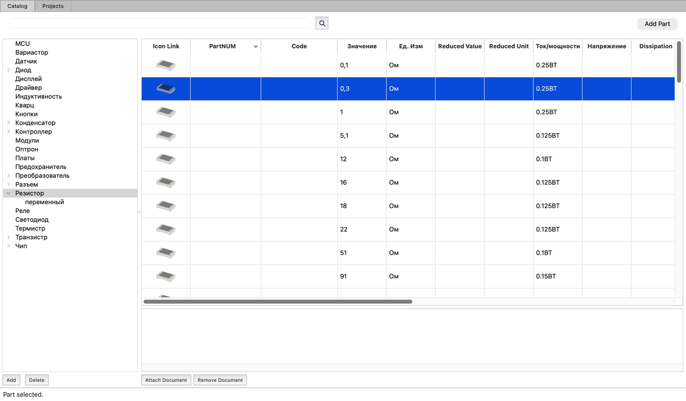

# PartsDB

[English version](README.md)

PartsDB (заголовок окна: *Electronic parts workbench*) — небольшое настольное приложение для учёта
электронных компонентов и их документации. Написано на Python и PyQt6, все данные хранятся в одном файле SQLite.



## Возможности

- **Дерево разделов.** Детали разложены по дереву типов и подтипов любой глубины,
  например `Транзистор / MOSFET / N-Канал` или `Диод / Шоттки`.
  Разделы добавляются, переименовываются и удаляются кнопками под деревом и через его контекстное меню.
- **Таблица деталей.** При выборе раздела его детали показываются в таблице с набором стандартных полей
  (партномер, код на корпусе, номинал, единицы, ток/мощность, напряжение, корпус, описание, количество, наличие…).
  Колонки настраиваются для каждого раздела: их можно переименовать, скрыть, вернуть и выровнять через
  контекстное меню заголовка или в **Setup → Edit headers**.
- **Картинки деталей.** Колонка *Icon Link* показывает изображение детали, во всплывающей подсказке — увеличенное.
  Деталям без своей картинки подставляется значок по умолчанию, выбранный по разделу и корпусу (SMD или выводной).
- **Поиск** по всем деталям из строки над таблицей. Найденную деталь можно открыть в её разделе.
- **Добавление, удаление и перенос деталей.** Кнопка *Add Part* и контекстное меню таблицы добавляют и удаляют детали.
  Выделенные строки можно перетащить на другой раздел в дереве — детали перейдут туда.
- **Документы.** У каждой детали есть список связанных документов: даташиты, схемы, изображения, файлы KiCad,
  веб-ссылки. Их добавляют кнопкой *Attach Document* или перетаскиванием файла из Finder или ссылки из браузера
  в область документов. Двойной щелчок открывает документ в приложении, назначенном для расширения файла
  (**Setup → Docs open exe**).
- **Несколько баз.** **File → Open DB** (`Ctrl+O`) и **File → Create new DB** (`Ctrl+N`).



## Установка

Нужен Python 3.11 или новее (текущая сборка — на Python 3.14).

```bash
git clone https://github.com/abel-msk/PartsDB
```

```bash
cd PartsDB
```

Настоятельно рекомендуется виртуальное окружение
(подробнее: https://docs.python.org/3/library/venv.html):

```bash
python3 -m venv venv
```

```bash
source venv/bin/activate
```

Установите зависимости:

```bash
pip install PyQt6 PyYAML pyinstaller
```

| Пакет        | Для чего                                                        |
|--------------|-----------------------------------------------------------------|
| PyQt6        | интерфейс                                                       |
| PyYAML       | файл настроек                                                   |
| pyinstaller  | сборка самостоятельного приложения                              |
| openpyxl     | только для `ELImport.py` (разовый импорт из списка Excel)       |
| PySide6      | только для `updateui.sh` (ресурсы собираются через `pyside6-rcc`) |

### Сборка приложения

```bash
./build.sh
```

PyInstaller создаёт `dist/ElPartsDB`, а на macOS — `dist/ElPartsDB.app`.
Скопируйте `.app` в `/Applications`.

Значок приложения — `icons/ElPartsCatalog.icns`, значок окна — `icons/main1.png`.

## Запуск

```
ElPartsDB [-c CONFIG] [-d DBFILE] [-l LOGFILE] [-v]

  -c, --config   Путь к файлу настроек
  -d, --dbpath   Путь к файлу базы SQLite
  -l, --logfile  Путь к файлу журнала. Весь вывод stderr тоже копируется туда
  -v, --verbose  Подробный журнал (уровень debug). Без ключа пишутся только ошибки
```

### Настройки и данные

- Установленное приложение читает `~/.elworks/elworks.conf` (YAML). Папка создаётся при первом запуске.
- `main.db_file` — файл базы. Относительный путь берётся от `main.data_path`
  (по умолчанию — папка файла настроек). Если `db_file` не задан, приложение ищет
  `elworks.sqlite` в папке данных и в `~/.elworks`.
- Картинки деталей хранятся в папке значков внутри папки данных. Если её нет, она создаётся.
- `main.log_level` — `err` или `debug`, `main.log_file` — путь к журналу (по умолчанию `/tmp/elworks.log`).
- Размер и положение окна и приложения для открытия документов сохраняются в тот же файл при выходе.

Пример:

```yaml
main:
  data_path: ~/.elworks
  db_file: elworks.sqlite
  log_level: err
application_PDF_View:
  ext: pdf
  exec: /System/Applications/Preview.app
  args: '{file}'
```

## Доработка

Запуск из исходников:

```bash
python main.py -c tests/elworks.test.conf -v
```

При запуске из исходников без `-c` используется `tests/elworks.test.conf`,
так что рабочая база в `~/.elworks` не затрагивается. Тестовые базы (`tests/*.sqlite`)
в git не хранятся: положите копию своей базы в `tests/` и укажите её в `db_file`
файла `tests/elworks.test.conf`.

### Структура проекта

| Файл                                        | Содержимое                                                 |
|---------------------------------------------|------------------------------------------------------------|
| `main.py`                                   | точка входа: ключи, настройки, база, журнал                |
| `ElMainWindow.py`                           | главное окно, меню, перетаскивание                         |
| `ElTypesTree.py`                            | дерево разделов                                            |
| `ElPartsTable.py`                           | таблица деталей, меню колонок, поиск                       |
| `ElIconDelegate.py`, `ElDefaultIcons.py`    | картинки деталей в таблице и значки по умолчанию           |
| `ElIconListWidget.py`                       | список документов детали                                   |
| `ElDBScheme.py`                             | схема базы и доступ к ней (`DBFactory`, `Type`, `Part`, …) |
| `ElConfig.py`, `constants.py`               | файл настроек и его ключи                                  |
| `ElAppList.py`, `ElAppPathDialog.py`, `ElProcess.py` | приложения для открытия документов                |
| `ElHdrEditDialog.py`                        | редактор заголовков колонок                                |
| `ELImport.py`                               | импорт из списка Excel                                     |
| `qt/*.ui`, `qt/resources.qrc`               | формы Qt Designer и ресурсы                                |

### Изменение интерфейса

Формы правятся в Qt Designer (`qt/*.ui`). Сгенерированные файлы `ElParts.py`, `ElAppPathWnd.py`,
`ElOpenFileWnd.py`, `ElHdrEditWnd.py` и `resources.py` вручную не редактируются. Пересоздайте их:

```bash
./updateui.sh
```

### Тесты

```bash
python -m unittest discover -s tests -v
```

Тесты работают с тестовой базой в `tests/` и платформой Qt offscreen.
