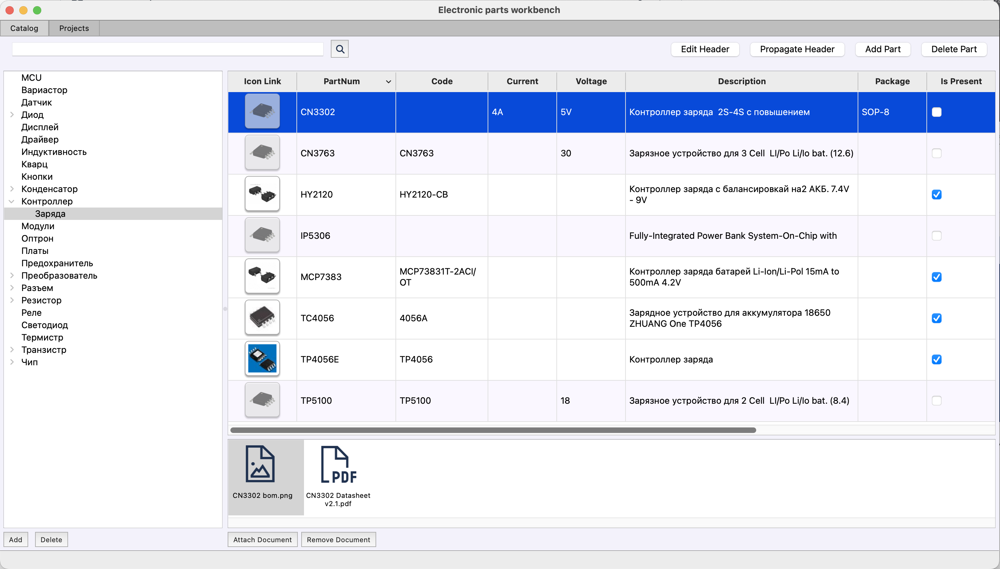
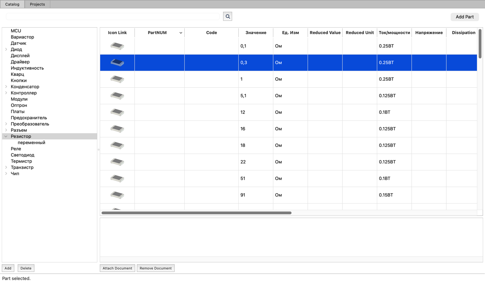

# PartsDB 1.3

[English version](README.md)

PartsDB (заголовок окна: *Electronic parts workbench*) — небольшое настольное приложение для учёта
электронных компонентов и их документации. Написано на Python и PyQt6, все данные хранятся в одном файле SQLite.



- Картинку с рабочего стола или из браузера можно перетащить на ячейку иконки детали: она заменит значок, а строка станет активной. Изображения сохраняются в папку иконок в формате PNG с уникальными именами и размером до 512 пикселей по длинной стороне.
- Исправлено падение на macOS при сохранении картинки из браузера с цветовым профилем ICC, а также активация перетаскивания при входе в таблицу через другую колонку.
- В редактор заголовков добавлены выбор раздела и выбор значка по умолчанию.
- Исправлен сброс скрытых колонок при сохранении ширины; после редактирования заголовки перечитываются.
- Иконки получили скруглённые рамки и тени, высота строк увеличена до 60 пикселей.
- Добавлены регрессионные тесты перетаскивания и параметры скрипта сборки: `-t` — все тесты, `-b` — сборка, `-tb` — тесты перед сборкой. PyInstaller запускается из виртуального окружения проекта.
- При нативном падении стек Python записывается в журнал приложения. Техническое описание: [обход ошибки перетаскивания картинок](docs/img_drop_hack.md) (на английском).
- Добавлена лицензия MIT.

## Возможности

- **Язык интерфейса.** **Настройки → Язык → English / Русский / Системный** переключает интерфейс
  без перезапуска, включая открытые диалоги. Выбор сохраняется в конфиге. Названия разделов,
  данные деталей и пользовательские заголовки колонок не переводятся.
- **Дерево разделов.** Детали разложены по дереву типов и подтипов любой глубины,
  например `Транзистор / MOSFET / N-Канал` или `Диод / Шоттки`.
  Разделы добавляются, переименовываются и удаляются кнопками под деревом и через его контекстное меню.
- **Таблица деталей.** При выборе раздела его детали показываются в таблице с набором стандартных полей
  (партномер, код на корпусе, номинал, единицы, ток/мощность, напряжение, корпус, описание, количество, наличие…).
  Колонки настраиваются для каждого раздела: их можно переименовать, скрыть, вернуть и выровнять через
  контекстное меню заголовка или в **Setup → Edit headers**.
- **Картинки деталей.** Колонка *Icon Link* показывает изображение детали, во всплывающей подсказке — увеличенное.
  Деталям без своей картинки подставляется значок по умолчанию, выбранный по разделу и корпусу (SMD или выводной).
- **Поиск** по всем деталям из строки над таблицей. Найденную деталь можно открыть в её разделе.
- **Добавление, удаление и перенос деталей.** Кнопка *Add Part* и контекстное меню таблицы добавляют и удаляют детали.
  Кнопка *Delete Part* запрашивает подтверждение, удаляет выбранную деталь и связи с документами,
  а также её иконку из папки значков. Файлы документов остаются на диске.
  Старые связи проекта с деталью блокируют удаление. Для сопоставлений импортированных позиций
  после предупреждения удаляются связи; сами позиции проекта сохраняются для повторного подбора.
  Выделенные строки можно перетащить на другой раздел в дереве — детали перейдут туда.
- **Документы.** У каждой детали есть список связанных документов: даташиты, схемы, изображения, файлы KiCad,
  веб-ссылки. Их добавляют кнопкой *Attach Document* или перетаскиванием файла из Finder или ссылки из браузера
  в область документов. Двойной щелчок открывает документ в приложении, назначенном для расширения файла
  (**Setup → Docs open exe**).
- **Несколько баз.** **File → Open DB** (`Ctrl+O`) и **File → Create new DB** (`Ctrl+N`).
  При создании базы открывается диалог выбора файла, создаётся пустая база SQLite и приложение переключается на неё.
  Существующие файлы не перезаписываются. Для наполнения новой базы добавьте разделы и детали.

- **Проекты и импорт KiCad.** Установите wheel импортёра через **Настройки → Плагины…**,
  затем добавьте проект на вкладке **Проекты**. Перед записью показывается перечень компонентов.
  Повторный импорт сохраняет сопоставления со складом и отмечает изменённые требования для перепроверки.
  Импорт не меняет остатки; подтверждённые связи можно изменять через контекстное меню компонента.
- **Менеджер плагинов.** Установка и обновление из wheel, замена импортёром той же системы,
  включение, отключение, удаление и просмотр журнала. Плагины выполняются в отдельных окружениях
  и процессах Python. Для плагинов в собранном приложении нужен установленный Python 3.9+.



## Установка

Нужен Python 3.11 или новее (текущая сборка — на Python 3.14).

```bash
git clone https://github.com/abel-msk/PartsDB
```

```bash
cd PartsDB
```

Настоятельно рекомендуется виртуальное окружение
(подробнее: https://docs.python.org/3/library/venv.html):

```bash
python3 -m venv venv
```

```bash
source venv/bin/activate
```

Установите зависимости:

```bash
pip install PyQt6 PyYAML pyinstaller
```

| Пакет        | Для чего                                                        |
|--------------|-----------------------------------------------------------------|
| PyQt6        | интерфейс                                                       |
| PyYAML       | файл настроек                                                   |
| pyinstaller  | сборка самостоятельного приложения                              |
| openpyxl     | только для `ELImport.py` (разовый импорт из списка Excel)       |
| PySide6      | необязателен: нужен только для генерации UI и ресурсов (`./build.sh -u`); не устанавливайте, если не планируете менять или генерировать UI |

Формы интерфейса редактируются в **Qt Designer**. PySide6 — это Python-пакет; для открытия и редактирования форм в Qt Designer он не нужен. Устанавливайте его только для генерации Python-файлов интерфейса и ресурсов.

### Сборка приложения

```bash
./build.sh -b
```

Перегенерация интерфейса и ресурсов запускается командой `./build.sh -u`, все
юнит-тесты — `./build.sh -t`, тесты с последующей сборкой — `./build.sh -tb`.
Команда `./build.sh -a` выполняет полный цикл: генерацию интерфейса, тесты и
сборку. Если тесты не проходят, сборка не запускается.

Исходники плагина находятся в `ElPartsPluginSrc/kicad`.
SDK определяет типы `project_import`, `parts_order` и `shipment_tracking`.
Плагин объявляет тип в манифесте и `get_plugin_type()`; PartsDB проверяет его
перед использованием и сохраняет в SQLite `PLUGINS` (схема 6).


Ключ `./build.sh -p` собирает wheel плагина KiCad в `dist/plugins/`.
Команда `./build.sh -tp` сначала запускает все тесты, затем собирает плагин.
Ключ `-p` включается отдельно от сборки приложения (`-b` и `-a`).
Команда `./build.sh -tpb` запускает тесты, очищает тестовые БД и собирает приложение и плагин.
Для wheel нужен pip и setuptools с поддержкой `bdist_wheel` либо пакет wheel.
Установка, импорт и повторная загрузка: [инструкция](docs/plugin-runtime.md).

PyInstaller создаёт `dist/ElPartsDB`, а на macOS — `dist/ElPartsDB.app`.
Скопируйте `.app` в `/Applications`.

Значок приложения — `icons/ElPartsCatalog.icns`, значок окна — `icons/main1.png`.

## Запуск

```
ElPartsDB [-c CONFIG] [-d DBFILE] [-l LOGFILE] [-v]

  -c, --config   Путь к файлу настроек
  -d, --dbpath   Путь к файлу базы SQLite
  -l, --logfile  Путь к файлу журнала. Весь вывод stderr тоже копируется туда
  -v, --verbose  Подробный журнал (уровень debug). Без ключа пишутся только ошибки
```

### Настройки и данные

- Установленное приложение читает `~/.elworks/elworks.conf` (YAML). Папка создаётся при первом запуске.
- `main.db_file` — файл базы. Относительный путь берётся от `main.data_path`
  (по умолчанию — папка файла настроек). Если `db_file` не задан, приложение ищет
  `elworks.sqlite` в папке данных и в `~/.elworks`.
- Картинки деталей хранятся в папке значков внутри папки данных. Если её нет, она создаётся.
- `main.log_level` — `err` или `debug`, `main.log_file` — путь к журналу (по умолчанию `/tmp/elworks.log`).
- `main.language` — `system` (по умолчанию), `en` или `ru`. Для неподдерживаемого системного языка используется английский.
- Размер и положение окна и приложения для открытия документов сохраняются в тот же файл при выходе.

Пример:

```yaml
main:
  data_path: ~/.elworks
  db_file: elworks.sqlite
  log_level: err
  language: system
application_PDF_View:
  ext: pdf
  exec: /System/Applications/Preview.app
  args: '{file}'
```

## Доработка

Запуск из исходников:

```bash
python main.py -c tests/elworks.test.conf -v
```

При запуске из исходников без `-c` используется `tests/elworks.test.conf`,
так что рабочая база в `~/.elworks` не затрагивается. Тестовые базы (`tests/*.sqlite`)
в git не хранятся: положите копию своей базы в `tests/` и укажите её в `db_file`
файла `tests/elworks.test.conf`.

### Структура проекта

| Файл                                        | Содержимое                                                 |
|---------------------------------------------|------------------------------------------------------------|
| `main.py`                                   | точка входа: ключи, настройки, база, журнал                |
| `ElMainWindow.py`                           | главное окно, меню, перетаскивание                         |
| `ElTypesTree.py`                            | дерево разделов                                            |
| `ElPartsTable.py`                           | таблица деталей, меню колонок, поиск                       |
| `ElIconDelegate.py`, `ElDefaultIcons.py`    | картинки деталей в таблице и значки по умолчанию           |
| `ElIconListWidget.py`                       | список документов детали                                   |
| `ElData/ElDBConnect.py` | SQLite-соединение, транзакции и системные метаданные |
| `ElData/ElDBScheme.py`                             | схема базы и доступ к ней (`DBFactory`, `Type`, `Part`, …) |
| `ElConfig.py`, `constants.py`               | файл настроек и его ключи                                  |
| `ElAppList.py`, `ElAppPathDialog.py`, `ElProcess.py` | приложения для открытия документов                |
| `ElHdrEditDialog.py`                        | редактор заголовков колонок                                |
| `ELImport.py`                               | импорт из списка Excel                                     |
| `ElPartsPluginSrc/kicad/`                   | исходники импортёра KiCad, манифест и настройки wheel      |
| `ElPartsPluginApi/`                        | публичные модели, манифест и контекст импортёров           |
| `ElPluginMgr/`                           | установка, реестр, протокол процесса и запись проекта     |
| `ElPluginsDialog.py`, `ElPluginMgr/ElProjectImports.py`, `ElImportTask.py`, `ElImportPreview.py` | интерфейс установки и импорта |
| `ElProjList.py`, `ElProjWindow.py`          | проекты, импортированные позиции и сопоставления          |
| `tests/input/`, `tests/kikad_plugin/`       | тестовый проект KiCad и тесты импортёра, БД и интерфейса   |
| `tools/cleanup_test_databases.py`           | очистка после успеха и ротация бэкапов при ошибке          |
| `qt/*.ui`, `qt/resources.qrc`               | формы Qt Designer и ресурсы                                |

### Изменение интерфейса

Формы правятся в Qt Designer (`qt/*.ui`). Сгенерированные файлы `ElParts.py`, `ElAppPathWnd.py`,
`ElOpenFileWnd.py`, `ElHdrEditWnd.py` и `resources.py` вручную не редактируются. Пересоздайте их:

```bash
./updateui.sh
```

### Тесты

```bash
./build.sh -t
```

Тесты работают с тестовой базой в `tests/` и платформой Qt offscreen.

После успешного прогона `./build.sh -t` удаляет временную `test_db.sqlite`
в корне проекта вместе с SQLite sidecar-файлами и бэкапы тестовых БД
непосредственно в `tests/`. При ошибке временная БД сохраняется, а для каждой
базы остаются три последних бэкапа. Исходная `tests/imported.sqlite`, входные
данные и архивные фикстуры сохраняются. После прямого запуска unittest используйте
`python tools/cleanup_test_databases.py --success` при успехе или `--failed`
при ошибке.

### Документация плагинов

- [Установка, импорт, конфигурация и очистка тестовых БД](docs/plugin-runtime.md).
- [Архитектура и публичный API](docs/plugin-architecture-and-api.md).
- [Менеджер плагинов и интерфейс проектов](docs/plugins-ui.md).
- [Схема БД](docs/database-plugins-and-parts.md) и [миграция импорта](docs/project-import-schema.md).
- [Пример вывода KiCad и раскладка по полям БД](docs/kicad-import-output-and-database-mapping.md).
- [Исходники и команды импортёра KiCad](ElPartsPluginSrc/kicad/README.md).

### Правила доступа к БД

Запросы приложения находятся в `ElData/ElDBScheme.py`. SQLite-соединение,
транзакции, PRAGMA и системные метаданные — в `ElData/ElDBConnect.py`.
Тестам разрешён прямой доступ к SQLite; корневой `connector.py` удалён.
Интерфейс и сервисы вызывают методы слоя БД. [Методы SQLite-драйвера](docs/sqlite-driver.md).
Правила именования файлов данных, размещения констант и описания классов/методов
записаны в [AGENTS.md](AGENTS.md). Перенос существующих классов данных и общих
констант выполняется по отдельной команде.

### Переводы

Каталоги Qt находятся в `translations/partsdb_en.ts` и `translations/partsdb_ru.ts`.
Исходные строки написаны на английском; файлы `.qm` включены для запуска из исходников.
В Python используйте `translate("PartsDB", "Source text")`, для подписей действий и стандартных колонок —
`QT_TRANSLATE_NOOP("PartsDB", "Source text")`. Заголовки и подписи окон задаются в
`ElWindowTexts.py`: для каждого окна предусмотрена отдельная функция, вызываемая при инициализации
и смене языка. Тексты окон для двух языков меняйте в этом модуле; Python-файлы, генерируемые
`updateui.sh`, вручную не редактируйте. Исходная разметка форм остаётся в файлах `.ui`.

```bash
python tools/translations.py --update
# Отредактируйте .ts в Qt Linguist, затем:
python tools/translations.py --check --compile
```

Для компиляции нужен `lrelease` из Qt Linguist (или `pyside6-lrelease`) в PATH либо в папке исполняемых файлов Qt.
`build.sh -b` проверяет и компилирует каталоги, затем включает их и русский перевод стандартных диалогов Qt в сборку.
Скрипт извлечения поддерживает Python 3.14, где pylupdate6 6.10.0 ещё обращается к удалённым AST API.

Ключевые колонки, базовые типы секций, общий вид списков и сохранение ширин таблиц
проектов описаны в [документации каталога](docs/catalog-keys-and-layout.md).
