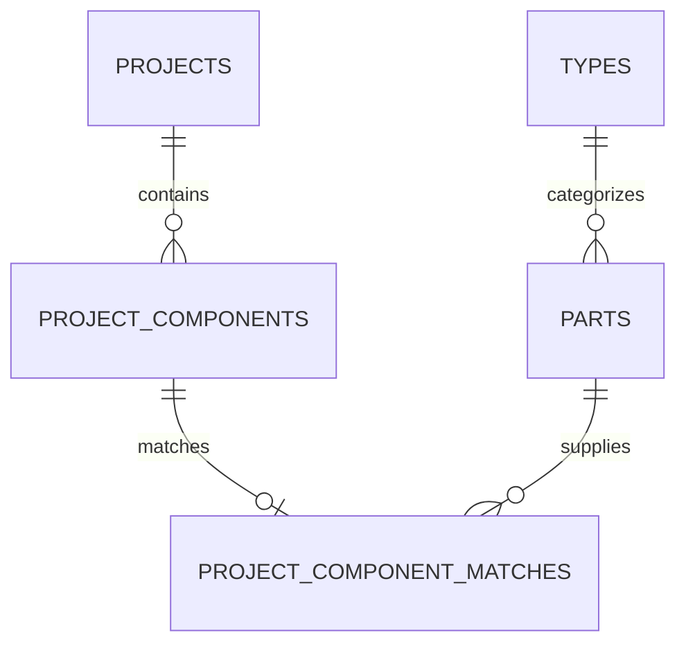

# Структура базы для плагинов импорта и деталей

Актуальность: 19.11.2026. Версия схемы приложения: **6**. Источник структуры — `ElData/ElDBScheme.py`; документ описывает создание новой базы и миграцию существующей, без проверки или изменения личной базы склада.

## Назначение таблиц

| Таблица | Назначение |
|---|---|
| PLUGINS | Метаданные установленных плагинов и их функциональный тип. |
| PROJECTS | Карточка проекта, URI источника и связь с текущим плагином. |
| PROJECT_COMPONENTS | Все импортированные физические позиции проекта. |
| PROJECT_COMPONENT_MATCHES | Выбранные соответствия позиций деталям склада. |
| PARTS | Карточки деталей склада, независимо от проектов. |

Метаданные установленных плагинов сохраняются в `PLUGINS`, пути к окружениям — в файловом реестре `plugins.json`. Метаданные плагина, включая поддерживаемую систему (например KiCad), должен предоставлять сам плагин. Менеджер, публичный API и слой транзакционной записи реализованы; порядок работы описан в [инструкции runtime](plugin-runtime.md).

## Связи

Один проект использует один текущий плагин и может импортироваться многократно. Одна позиция проекта может иметь одно выбранное соответствие или оставаться несопоставленной. Одна деталь склада может соответствовать многим позициям разных проектов.

## PLUGINS

| Поле | Тип | Содержание |
|---|---|---|
| `id` | TEXT PRIMARY KEY NOT NULL | ID плагина из манифеста |
| `plugin_type` | TEXT NOT NULL | `project_import`, `parts_order` или `shipment_tracking`; CHECK по трём глобальным константам |
| `name`, `version` | TEXT NOT NULL | Название и версия пакета |
| `api_version` | INTEGER NOT NULL | Версия API |
| `system_id`, `system_name` | TEXT NOT NULL | Машинный ID и название внешней системы |
| `description`, `author` | TEXT NOT NULL | Описание и автор |
| `enabled` | INTEGER NOT NULL | 0/1, ограничение CHECK |
| `manifest_json` | TEXT NOT NULL | Полный манифест, включая тип и точку входа |

Тип задаётся плагином, сверяется с `get_plugin_type()` в отдельном процессе
и сохраняется только после успешной проверки установки. Для KiCad это
`PLUGIN_TYPE_IMPORT = 'project_import'`. Общие константы: `ElPartsPluginApi/constants.py`.
Обновление и замена другим плагином требуют того же типа и внешней системы.

Менеджер сохраняет метаданные в текущей БД и синхронизирует их с реестром
окружений при открытии окна или переключении БД. Записи `PROJECTS.plugin_id`
не имеют внешнего ключа на `PLUGINS`, чтобы удаление плагина сохраняло данные
проектов. Сама таблица не содержит операций заказа или отслеживания.

## PROJECTS

| Имя | Тип | Описание |
|---|---|---|
| `id` | INTEGER | Внутренний ID проекта. Ограничения: первичный ключ, NULL запрещён. |
| `name` | TEXT | Имя проекта, возвращённое плагином. |
| `descr` | TEXT | Описание проекта, возвращённое плагином. |
| `plugin_id` | TEXT | ID текущего плагина. Для старых проектов без выбранного плагина допускается NULL. |
| `external_id` | TEXT | ID проекта во внешней системе, возвращённый плагином. |
| `source_uri` | TEXT | URI, который PartsDB передаёт плагину: file://, http:// или https://. Для старой карточки без пути допускается NULL. |
| `last_imported_at` | TEXT | Время последнего успешного импорта в UTC. До первого успешного импорта NULL. |
| `needs_reload` | INTEGER | Требуется повторный импорт: 0 или 1. Ограничения: NULL запрещён, по умолчанию `1`. |
| `properties_json` | TEXT | Дополнительные свойства проекта в JSON, возвращённые плагином. Ограничения: NULL запрещён, по умолчанию `'{}'`. |

Плагину передаётся только `source_uri`. `id`, `plugin_id`, `source_uri`, `last_imported_at` и `needs_reload` обслуживает PartsDB. Остальные сведения проекта возвращает плагин. SQL допускает NULL в необязательных полях; структуру результата проверяют `protocol.py` и `ProjectRepository`.

## PROJECT_COMPONENTS

| Имя | Тип | Описание |
|---|---|---|
| `id` | INTEGER | Внутренний ID позиции. Ограничения: первичный ключ, NULL запрещён. |
| `project_id` | INTEGER | Ссылка на PROJECTS.id. Ограничения: NULL запрещён. |
| `external_id` | TEXT | Устойчивый ID физического экземпляра компонента, возвращённый плагином. Ограничения: NULL запрещён. |
| `reference` | TEXT | Обозначение: R1, U6 и т. п. Ограничения: NULL запрещён. |
| `kind` | TEXT | Категория компонента: например resistor, capacitor, ic; неизвестная категория — unknown. Ограничения: NULL запрещён, по умолчанию `'unknown'`. |
| `value_raw` | TEXT | Исходное значение или модель без нормализации: например 51k, CN3763. Ограничения: NULL запрещён, по умолчанию `''`. |
| `nominal_value` | TEXT | Нормализованное число десятичной строкой: например 51000 или 0.002. |
| `nominal_unit` | TEXT | Единица нормализованного номинала: например ohm, F, H. |
| `model` | TEXT | Модель детали, если её можно определить. |
| `symbol_id` | TEXT | Полное имя библиотечного символа. |
| `footprint` | TEXT | Полное имя посадочного места. |
| `description` | TEXT | Описание компонента. |
| `in_bom` | INTEGER | Включён в перечень деталей: 0 или 1. Ограничения: NULL запрещён, по умолчанию `1`. |
| `on_board` | INTEGER | Размещается на плате: 0 или 1. Ограничения: NULL запрещён, по умолчанию `1`. |
| `dnp` | INTEGER | Не устанавливать: 0 или 1. Ограничения: NULL запрещён, по умолчанию `0`. |
| `properties_json` | TEXT | Дополнительные исходные свойства компонента в JSON. Ограничения: NULL запрещён, по умолчанию `'{}'`. |

Одна строка — одна физическая позиция; секции одного многосекционного компонента объединяет плагин. Количество одинаковых деталей вычисляется группировкой. Пара **`(project_id, external_id)` уникальна**. Столбцов страниц или листов нет.

## PROJECT_COMPONENT_MATCHES

| Имя | Тип | Описание |
|---|---|---|
| `component_id` | INTEGER | Ссылка на PROJECT_COMPONENTS.id. Одно выбранное соответствие на позицию. Ограничения: первичный ключ, NULL запрещён. |
| `part_id` | INTEGER | Выбранная деталь склада, ссылка на PARTS.id. Ограничения: NULL запрещён. |
| `needs_review` | INTEGER | Требуется перепроверить соответствие: 0 или 1. Ограничения: NULL запрещён, по умолчанию `0`. |
| `matched_at` | TEXT | Время сопоставления в UTC. Автоматически записывается текущий момент. Ограничения: NULL запрещён, по умолчанию `strftime('%Y-%m-%dT%H:%M:%fZ', 'now')`. |

Отсутствие строки означает, что деталь склада ещё не выбрана. Кандидаты для подбора не являются выбранными соответствиями.

## PARTS

| Имя | Тип | Описание |
|---|---|---|
| `id` | INTEGER | ID детали склада. Ограничения: первичный ключ, NULL запрещён. |
| `type_id` | INTEGER | Раздел склада, ссылка на TYPES.id. Ограничения: NULL запрещён. |
| `part_num` | TEXT | Название, модель или маркировка; у R/C/L может быть пустым. |
| `device_code` | TEXT | Значение зависит от раздела: код корпуса, номинал или серия. Читать заголовок HEADERS.display. |
| `value` | REAL | Исходный номинал/значение. У стабилитронов — порог Vz; смысл зависит от раздела. |
| `units` | TEXT | Единица исходного значения; скрытые столбцы игнорировать. |
| `reduced_val` | REAL | Нормализованное значение для сравнения номиналов. |
| `reduced_val_units` | TEXT | Единица нормализованного значения. |
| `max_current` | TEXT | Ток или мощность в зависимости от раздела; у разъёмов — шаг в мм. |
| `max_voltage` | TEXT | Предельное напряжение; учитывать заголовок раздела. |
| `max_desumption` | TEXT | Рассеиваемая мощность; учитывать заголовок раздела. |
| `description` | TEXT | Описание детали. |
| `package` | TEXT | Корпус детали. |
| `present` | BOOLEAN | Признак наличия. В существующих данных наличие: 1 или строка True. |
| `quantity` | INTEGER | Количество на складе; NULL/пусто при наличии означает неизвестное количество. |
| `price` | REAL | Цена единицы. |
| `currency` | TEXT | Валюта цены. |
| `shop` | TEXT | Ссылка на магазин. |
| `local_location` | TEXT | Место хранения. |
| `icon` | TEXT | Путь к изображению детали. |

## Правила импорта и замены плагина

- После успешного импорта PartsDB обновляет `last_imported_at` и устанавливает `needs_reload = 0`. Неудачная попытка не меняет время последнего успеха.
- При замене плагином той же системы меняется `plugin_id` и устанавливается `needs_reload = 1`. Обновление с прежним ID тоже требует повторного импорта.
- Ранее импортированные данные сохраняются до успешной перезагрузки проекта.
- Старый плагин удаляется после успешной установки, проверки и переключения на новый.
- `external_id` проекта и `external_id` компонента относятся к разным сущностям. Для повторного импорта компоненты сопоставляются по `(project_id, external_id)`, а не только по обозначению.
- JSON хранится как TEXT. Протокол и repository проверяют структуру результата, обязательные поля и сериализацию; `kind` допускает непустую строку без закрытого enum. Поддержку URI определяет импортёр. SQL этих проверок не выполняет.

## Индексы и ограничения

- `PROJECT_COMPONENTS`: уникальный индекс SQLite по `(project_id, external_id)`, также используемый для поиска компонентов проекта.
- `PROJECT_COMPONENT_MATCHES`: первичный ключ `component_id` и индекс `idx_project_component_matches_part` по `part_id`.
- `PROJECTS.id`, `PROJECT_COMPONENTS.id`, `PARTS.id`: `INTEGER PRIMARY KEY AUTOINCREMENT`.
- Все флаги `needs_reload`, `needs_review`, `in_bom`, `on_board`, `dnp` имеют ограничения `NOT NULL` и `CHECK (... IN (0, 1))`.
- Связи `PROJECTS → PROJECT_COMPONENTS → PROJECT_COMPONENT_MATCHES` и `PARTS → PROJECT_COMPONENT_MATCHES` объявлены с `ON DELETE CASCADE`.

## Удаление

При удалении детали склада через PartsDB перед подтверждением показывается предупреждение о числе затрагиваемых сопоставлений. Удаляются сопоставления, а позиции проекта сохраняются для повторного подбора. Изменения БД выполняются одной транзакцией; при отмене или ошибке данные сохраняются.

Каскады работают при `PRAGMA foreign_keys=ON`. `DBScheme` включает этот режим перед транзакцией импорта, удаления проекта или изменения сопоставления; `ProjectRepository` делегирует эти операции без SQL. Обычный коннектор не включает его при открытии соединения; при удалении детали её сопоставления удаляются явно. Удаление проекта также явно удаляет старые связи `EL_BY_PROJECT`.

## Связанные таблицы и особенности склада

- `TYPES` задаёт дерево разделов. `PARTS.type_id` ссылается на раздел; путь раздела строится по `TYPES.parent_id`.
- `HEADERS` определяет отображаемые названия и смысл полей `PARTS` для конкретного раздела; поля с `hidden = 1` не участвуют в интерпретации. Поэтому совпадение имени поля не гарантирует одинаковые единицы или смысл.
- `DATASHEETS` хранит ссылки на документы и изображения деталей через `part_id`.
- `EL_BY_PROJECT(id, project_id, part_id, quantity)` — существующая старая связь деталей и проектов. В текущем коде её записи блокируют удаление детали. Для импортированных позиций используется `PROJECT_COMPONENT_MATCHES`; автоматическое дублирование потребности в `EL_BY_PROJECT` не предусмотрено.
- При сравнении R/C/L использовать нормализованное значение и единицы, а при подборе корпуса — сопоставление `footprint` с `PARTS.package`. Поле `nominal_value` импорта хранится как десятичный TEXT, `PARTS.reduced_val` — как REAL.

## Миграция 4 → 5

Миграция перестраивает `PROJECTS`, сохраняя ID, имена, описания, счётчик AUTOINCREMENT и старые связи `EL_BY_PROJECT`. Старое `schematic_path` переносится в `source_uri`: существующий URI сохраняется, локальный путь преобразуется в `file://`, относительный путь разрешается относительно папки БД. Исходные ресурсы при миграции не читаются.

Создание таблиц и запись версии выполняются атомарно. При ошибке миграция откатывается; повторное выполнение безопасно. Таблицы `PROJECT_SOURCES` и `PROJECT_IMPORTS`, а также поля `options_json`, `document_date`, `revision`, `source_path` и `schematic_path` в новой структуре не создаются.

Исходное краткое описание импорта: [project-import-schema.md](project-import-schema.md).

## Миграция 5 → 6

Создаётся `PLUGINS` и в той же транзакции записывается версия 6. При ошибке
версия и схема остаются прежними; повторная миграция безопасна. Миграция не
запускает плагины и не читает их пакеты: метаданные заполняет последующая
синхронизация с установленными окружениями. Проекты, позиции, склад и их ID
не перестраиваются. Изменения проверяются на временных БД.
