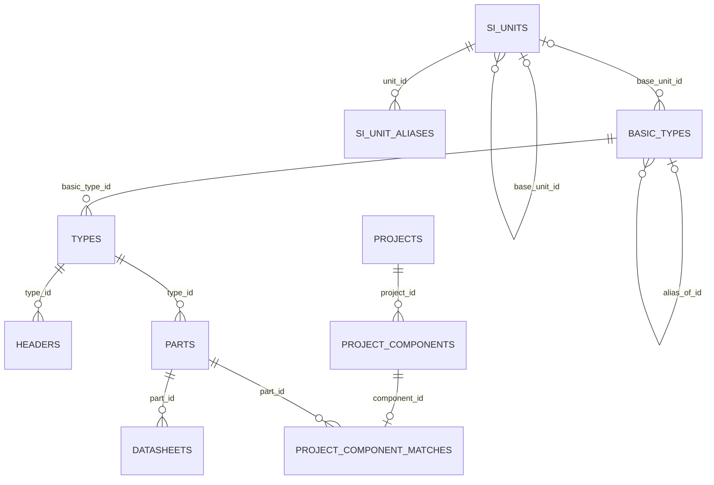

# Таблицы и справочники PartsDB

Актуальность: 21 ноября 2026. PartsDB **2.0**, схема БД **11**.
Это единый справочник текущих таблиц: поля, типы, ограничения, начальные значения
и правила интерпретации. Источник — `ElData/ElDBScheme.py` и `ElConstants.py`;
сведения сверены с новой временной БД, без обращения к личной базе склада.

- [Все миграции схемы](database-migrations.md).
- [Публичный API плагинов](plugin-architecture-and-api.md).
- [Импортёр KiCad и результат API](kicad-importer.md).
- [Редактор единиц и запуск приложений](units-and-project-applications.md).

## Назначение таблиц

| Таблица | Назначение |
|---|---|
| [BASIC_TYPES](#basic_types) | Справочник базовых типов компонентов и позиционных обозначений. |
| [SI_UNITS](#si_units) | Справочник основных единиц и десятичных приставок СИ. |
| [SI_UNIT_ALIASES](#si_unit_aliases) | Редактируемые дополнительные обозначения единиц. |
| [TYPES](#types) | Дерево разделов складского каталога. |
| [HEADERS](#headers) | Настройки колонок каталога и ключевых значений. |
| [PARTS](#parts) | Карточки деталей склада. |
| [DATASHEETS](#datasheets) | Ссылки на документы деталей. |
| [PLUGINS](#plugins) | Метаданные установленных плагинов и настройки открытия проектов. |
| [PROJECTS](#projects) | Импортированные проекты, их источники и состояние импорта. |
| [PROJECT_COMPONENTS](#project_components) | Физические позиции импортированных проектов. |
| [PROJECT_COMPONENT_MATCHES](#project_component_matches) | Подтверждённые соответствия позиций складским деталям. |
| [EL_BY_PROJECT](#el_by_project) | Старые связи проектов и деталей с количеством. |
| [PROJECT_COLUMN_WIDTHS](#project_column_widths) | Сохранённые ширины колонок двух таблиц проектов. |
| [ENVIRONMENT](#environment) | Служебные настройки базы, в том числе версия схемы. |

Все INTEGER PRIMARY KEY в перечисленных таблицах являются SQLite rowid-ключами;
AUTOINCREMENT отмечен отдельно. `NULL` разрешён, если нет NOT NULL или соответствующего
правила PK. SQL-типы и значения по умолчанию ниже показаны по фактической схеме.
`sqlite_sequence` — внутренняя таблица SQLite для счётчиков AUTOINCREMENT, не справочник приложения.

## Связи



На диаграмме показаны объявленные SQL-ссылки. `TYPES.parent_id`, `PROJECTS.plugin_id`
и обе ссылки `EL_BY_PROJECT` являются логическими связями без FOREIGN KEY.
Каскады требуют `foreign_keys=ON`. Коннектор не включает этот режим при открытии;
транзакции проектов и справочников включают его явно. Интерфейс и сервисы не исполняют SQL.

## BASIC_TYPES

Справочник базовых типов компонентов и позиционных обозначений.

| Поле | SQL-тип и ограничения | Назначение |
|---|---|---|
| `id` | INTEGER PK | Стабильный ID базового типа; ID 1 — Miscellaneous (разное). |
| `name` | TEXT NOT NULL | Уникальное английское название; не переводится при переключении интерфейса. |
| `designator` | TEXT NOT NULL | Буквенный префикс позиционного обозначения: R, C, U и т. п.; может быть пустым. |
| `icon` | TEXT | Необязательный путь к иконке. |
| `base_unit_id` | INTEGER | Основная единица СИ для типа; NULL, если единой единицы нет. |
| `alias_of_id` | INTEGER | Ссылка на BASIC_TYPES(id); NULL у обычного типа, заполнена у алиаса. |

`name` уникально. `base_unit_id` — nullable FOREIGN KEY на `SI_UNITS(id)`,
`DEFERRABLE INITIALLY DEFERRED`. В приложении ссылка допускается только на единицу
с множителем 1. Исходные связи: Capacitor → Farad, Resistor → Ohm, Inductor → Henry.
Для других типов единицу можно выбрать вручную или оставить пустой.

`alias_of_id` — отложенный FK на эту же таблицу; CHECK запрещает ссылку на себя.
Редактор допускает ссылки только на существующие обычные типы. Цепочки алиасов
и удаление типа с оставшимися алиасами отклоняются при сохранении.
Алиас сохраняет собственные название, обозначение, иконку и единицу СИ.

Исходный набор обозначений опирается на [KiCad Library Conventions, S6.1](https://klc.kicad.org/symbol/s6/s6.1/).
Это принятый набор приложения, а не единственный универсальный стандарт.

Начальный справочник (ID заданы порядком строк, от 1 до 33):

| Название | Обозначение |
|---|---|
| Miscellaneous | — |
| Capacitor | C |
| Resistor | R |
| Transistor | Q |
| Diode | D |
| Integrated circuit | U |
| Inductor | L |
| Transformer | T |
| Relay | K |
| Switch | SW |
| Jack | J |
| Plug | P |
| Battery | BT |
| Fuse | F |
| Ferrite bead | FB |
| Filter | FL |
| Display | DS |
| Loudspeaker or buzzer | LS |
| Motor | M |
| Microphone | MK |
| Antenna | AE |
| Jumper | JP |
| Resistor network | RN |
| Thermistor | RT |
| Varistor | RV |
| Thermocouple | TC |
| Test point | TP |
| Crystal or oscillator | Y |
| Zener diode | Z |
| Sub-assembly or module | A |
| Hardware | H |
| Fiducial | FD |
| Thermal jumper | TJ |

## SI_UNITS

Справочник основных единиц и десятичных приставок СИ.

| Поле | SQL-тип и ограничения | Назначение |
|---|---|---|
| `id` | INTEGER PK | Автоматический ID записи. |
| `name` | TEXT NOT NULL | Уникальное английское название, например Kiloohm. |
| `name_ru` | TEXT NOT NULL | Русское название, например Килоом. |
| `marker` | TEXT NOT NULL | Английское обозначение на схемах: R, k, M, uH, nF. |
| `marker_ru` | TEXT NOT NULL | Русское обозначение: Ом, к, М, мкГ, нФ. |
| `multiply` | REAL NOT NULL | Множитель приведения в основную единицу: значение × multiply. |
| `base_unit_id` | INTEGER | Ссылка на основную единицу с multiply=1; у основной единицы NULL. |

`id` использует AUTOINCREMENT, `name` уникально; `multiply > 0` проверяется SQL.
`base_unit_id` — nullable FOREIGN KEY на эту же таблицу,
`DEFERRABLE INITIALLY DEFERRED`. Основные единицы имеют `multiply=1` и NULL-ссылку;
производные ссылаются непосредственно на основную. Слой данных проверяет непустые
названия/обозначения, ASCII для английских полей, конечный положительный множитель,
существование основной единицы и отсутствие цепочек. Сам FK не проверяет множитель.
Удаление используемой основной единицы блокируется, пока оставшиеся ссылки не сняты.

Начальные основные единицы: Farad / Фарад (F / Ф), Henry / Генри (H / Г),
Ohm / Ом (R / Ом), Volt / Вольт (V / В), Ampere / Ампер (A / А).
Вместе с 24 приставками это 125 строк. Для килоома marker=k, marker_ru=к,
для мегаома M / М; для микрогенри uH / мкГ. У Microhenry множитель 1e-6.

| Приставка | Русская приставка | marker-префикс | Множитель |
|---|---|---|---|
| atto | атто | a | 1e-18 |
| femto | фемто | f | 1e-15 |
| pico | пико | p | 1e-12 |
| nano | нано | n | 1e-09 |
| micro | микро | u | 1e-06 |
| milli | милли | m | 0.001 |
| centi | санти | c | 0.01 |
| deci | деци | d | 0.1 |
| без приставки | без приставки | — | 1 |
| deca | дека | da | 10 |
| hecto | гекто | h | 100 |
| kilo | кило | k | 1000 |
| mega | мега | M | 1e+06 |
| giga | гига | G | 1e+09 |
| tera | тера | T | 1e+12 |
| peta | пета | P | 1e+15 |
| exa | экса | E | 1e+18 |
| zetta | зетта | Z | 1e+21 |
| yotta | иотта | Y | 1e+24 |
| ronna | ронна | R | 1e+27 |
| quetta | кветта | Q | 1e+30 |
| ronto | ронто | r | 1e-27 |
| quecto | квекто | q | 1e-30 |
| yocto | иокто | y | 1e-24 |
| zepto | зепто | z | 1e-21 |

## SI_UNIT_ALIASES

Дополнительные обозначения существующих единиц, редактируемые в колонке
«Алиасы» окна справочников. У алиаса нет собственного множителя или размерности:
они берутся из строки `SI_UNITS`, на которую он ссылается.

| Поле | SQL-тип и ограничения | Назначение |
|---|---|---|
| `unit_id` | INTEGER NOT NULL FK | Ссылка на SI_UNITS(id), удаление каскадное |
| `marker` | TEXT NOT NULL | Непустое альтернативное обозначение, включая Unicode |

Составной первичный ключ — `(unit_id, marker)`. Начальное заполнение добавляет
полные обозначения сопротивлений, например `кОм`, `kR`, `kΩ`, `kOhm` для Kiloohm
и `МОм` для Megaohm. ID существующих единиц и их множители сохраняются.
Начальные алиасы создаются только при создании таблицы; удалённые пользователем
обозначения при повторном открытии или миграции не восстанавливаются.

Для сопоставления обе стороны сравнения обозначений приводятся к верхнему регистру.
Если такое преобразование объединяет обозначения разных множителей, все
интерпретации остаются кандидатами; выбор складской карточки не подтверждается
автоматически. Хранение и сравнение отделены: таблица сохраняет введённое написание.

## TYPES

Дерево разделов складского каталога.

| Поле | SQL-тип и ограничения | Назначение |
|---|---|---|
| `id` | INTEGER PK | Автоматический ID раздела. |
| `name` | TEXT NOT NULL | Название раздела каталога. |
| `path` | TEXT | Сохранённый путь раздела; дерево определяется parent_id. |
| `parent_id` | INTEGER DEFAULT 0 | ID родителя; 0 обозначает корень. Логическая связь без FOREIGN KEY. |
| `icon` | TEXT | Необязательная иконка по умолчанию для деталей раздела. |
| `basic_type_id` | INTEGER NOT NULL DEFAULT 1 | Базовый тип раздела; начальное значение 1. |

`basic_type_id` — SQL-ссылка на `BASIC_TYPES(id)`. `parent_id` задаёт дерево
логически: 0 означает корень; отдельного FK и каскада для него нет. При создании
раздела приложение предлагает базовый тип родителя; последующее изменение типа
родителя не переписывает базовые типы уже существующих потомков.

## HEADERS

Настройки колонок каталога и ключевых значений.

| Поле | SQL-тип и ограничения | Назначение |
|---|---|---|
| `id` | INTEGER PK | Автоматический ID настройки колонки. |
| `type_id` | INTEGER NOT NULL | Раздел, которому принадлежит настройка. |
| `field_name` | TEXT NOT NULL | Имя поля PARTS, к которому относится настройка. |
| `label` | TEXT | Старое поле; отображаемое название хранится в display. |
| `align` | TEXT | Выравнивание: LEFT, RIGHT или CENTER на уровне приложения. |
| `hidden` | BOOLEAN | Скрытие колонки; скрытые значения не используются при интерпретации данных. |
| `sort` | BOOLEAN | Сохранённый флаг сортировки колонки. |
| `display` | TEXT | Название колонки в этом разделе; определяет смысл полей детали. |
| `width` | INTEGER | Сохранённая ширина колонки. |
| `position` | INTEGER | Позиция колонки в таблице; по умолчанию иконка первая. |
| `is_key` | BOOLEAN | Ключевое значение: 1 — ключ, 0 — обычная колонка, NULL — выбор по базовому типу. |

`type_id` — FOREIGN KEY на `TYPES(id) ON DELETE CASCADE`. Настройки колонок
наследуются от ближайшего предка, задавшего настройку; иначе используются встроенные
значения. Явное редактирование создаёт переопределение. `is_key=NULL` выбирает `value`
для Resistor и Capacitor, `part_num` для остальных типов. Ключевых колонок может быть
несколько, но интерфейс требует хотя бы одну. Сохранение ширины само по себе не
меняет выбор ключа. `label` не является отображаемым названием — используйте `display`.

## PARTS

Карточки деталей склада.

| Поле | SQL-тип и ограничения | Назначение |
|---|---|---|
| `id` | INTEGER PK | Автоматический ID детали. |
| `type_id` | INTEGER NOT NULL | Раздел каталога. |
| `part_num` | TEXT | Название, модель или маркировка; у R/C/L часто пусто. |
| `device_code` | TEXT | Код на корпусе, номинал либо серия — согласно HEADERS.display раздела. |
| `value` | REAL | Исходный номинал; у стабилитронов — Vz. Смысл зависит от раздела. |
| `units` | TEXT | Единица исходного номинала; текстовое поле не связано внешним ключом с SI_UNITS. |
| `reduced_val` | REAL | Нормализованное значение для сравнения R/C/L. |
| `reduced_val_units` | TEXT | Единица нормализованного значения. |
| `max_current` | TEXT | Ток или мощность по заголовку раздела; у разъёмов — шаг в мм. |
| `max_voltage` | TEXT | Предельное напряжение согласно заголовку раздела. |
| `max_desumption` | TEXT | Рассеиваемая мощность согласно заголовку раздела. |
| `description` | TEXT | Описание детали. |
| `package` | TEXT | Корпус детали. |
| `present` | BOOLEAN | Наличие: 1 или строка True означают «в наличии»; пустое значение — отсутствует. |
| `quantity` | INTEGER | Количество; пустое при present=1 означает неизвестное количество. |
| `price` | REAL | Цена единицы. |
| `currency` | TEXT | Валюта цены, текст. |
| `shop` | TEXT | Ссылка на магазин. |
| `local_location` | TEXT | Место хранения. |
| `icon` | TEXT | Путь к изображению детали. |

`id` использует AUTOINCREMENT. `type_id` — FOREIGN KEY на `TYPES(id) ON DELETE CASCADE`.
Другие значения интерпретируются по `HEADERS` соответствующего раздела; скрытые
колонки могут содержать устаревшие данные и не используются при подборе.

## DATASHEETS

Ссылки на документы деталей.

| Поле | SQL-тип и ограничения | Назначение |
|---|---|---|
| `id` | INTEGER PK | Автоматический ID документа. |
| `part_id` | INTEGER NOT NULL | Деталь, к которой относится документ. |
| `type` | INTEGER DEFAULT 1 | Тип документа: 1 — URL, 2 — PDF, 3 — JPEG, 4 — PNG, 5 — текст, 6 — общий/прочий тип (в данных склада также XLSX). |
| `uri` | TEXT | Путь к файлу или веб-ссылка; файл хранится вне SQLite. |

`id` использует AUTOINCREMENT, `part_id` ссылается на `PARTS(id) ON DELETE CASCADE`.
Ссылки в БД не означают хранение содержимого файлов в SQLite. При удалении ссылки
исходный документ остаётся на диске.

## PLUGINS

Метаданные установленных плагинов и настройки открытия проектов.

| Поле | SQL-тип и ограничения | Назначение |
|---|---|---|
| `id` | TEXT PK NOT NULL | Постоянный ID плагина из манифеста. |
| `plugin_type` | TEXT NOT NULL | Функциональный тип: project_import, parts_order или shipment_tracking. |
| `name` | TEXT NOT NULL | Название плагина. |
| `version` | TEXT NOT NULL | Версия установленного пакета. |
| `api_version` | INTEGER NOT NULL | Версия API плагина. |
| `system_id` | TEXT NOT NULL | Машинный ID поддерживаемой внешней системы. |
| `system_name` | TEXT NOT NULL | Отображаемое название внешней системы. |
| `description` | TEXT NOT NULL | Описание плагина. |
| `author` | TEXT NOT NULL | Автор плагина. |
| `enabled` | INTEGER NOT NULL | 0 или 1: разрешён ли запуск установленного плагина. |
| `manifest_json` | TEXT NOT NULL | Полный манифест, сериализованный в JSON. |
| `app_path` | TEXT NOT NULL DEFAULT '' | Путь к внешнему исполняемому файлу или macOS .app для открытия проекта. |
| `app_params` | TEXT NOT NULL DEFAULT '' | Шаблон аргументов внешнего приложения; {file} заменяется путём/URI проекта. |

`id` — обязательный текстовый PK. `plugin_type` имеет CHECK по трём типам API,
`enabled` — CHECK IN (0,1). Пути к изолированным окружениям хранятся в файловом
реестре `plugins.json`, а не в этой таблице. Синхронизация метаданных установки
не перезаписывает `app_path` и `app_params`. Удаление плагина удаляет его карточку
и настройки запуска, сохраняя проекты с его ID.

## PROJECTS

Импортированные проекты, их источники и состояние импорта.

| Поле | SQL-тип и ограничения | Назначение |
|---|---|---|
| `id` | INTEGER PK | Автоматический внутренний ID проекта. |
| `name` | TEXT | Название, возвращённое импортёром. |
| `descr` | TEXT | Описание, возвращённое импортёром. |
| `plugin_id` | TEXT | Текущий импортёр; логическая ссылка на PLUGINS без FOREIGN KEY. |
| `external_id` | TEXT | ID проекта во внешней системе. |
| `source_uri` | TEXT | Источник, переданный плагину: file URI, сетевой URI или поддерживаемый плагином путь. |
| `last_imported_at` | TEXT | Время последнего успешного сохранения импорта в UTC; до первого успеха NULL. |
| `needs_reload` | INTEGER NOT NULL DEFAULT 1 | 0 — импорт актуален, 1 — требуется повторный импорт. |
| `properties_json` | TEXT NOT NULL DEFAULT '{}' | Дополнительные свойства ImportedProject в JSON. |

`id` использует AUTOINCREMENT. `needs_reload` имеет CHECK IN (0,1).
У `plugin_id` нет FK: данные проекта должны сохраняться после удаления плагина.
`source_uri`, `plugin_id`, внутренний ID и состояние записи обслуживает PartsDB;
остальные сведения берутся из ImportedProject. Полей страниц и листов нет.

## PROJECT_COMPONENTS

Физические позиции импортированных проектов.

| Поле | SQL-тип и ограничения | Назначение |
|---|---|---|
| `id` | INTEGER PK | Автоматический внутренний ID позиции. |
| `project_id` | INTEGER NOT NULL | Проект-владелец позиции. |
| `external_id` | TEXT NOT NULL | Устойчивый внешний ID физического экземпляра. |
| `reference` | TEXT NOT NULL | Позиционное обозначение: R1, U6 и т. п. |
| `kind` | TEXT NOT NULL DEFAULT 'unknown' | Категория API: resistor, capacitor, ic и т. п.; неизвестная — unknown. |
| `value_raw` | TEXT NOT NULL DEFAULT '' | Исходное значение или модель без потерь: 51k, CN3763. |
| `nominal_value` | TEXT | Нормализованное число десятичной строкой TEXT, без приведения к float. |
| `nominal_unit` | TEXT | Нормализованная единица API: ohm, F, H и т. п.; не FK на SI_UNITS. |
| `model` | TEXT | Модель компонента, если распознана. |
| `symbol_id` | TEXT | Полное библиотечное имя символа. |
| `footprint` | TEXT | Полное библиотечное имя посадочного места. |
| `description` | TEXT | Описание позиции. |
| `in_bom` | INTEGER NOT NULL DEFAULT 1 | 0/1: включена ли позиция в BOM. |
| `on_board` | INTEGER NOT NULL DEFAULT 1 | 0/1: размещается ли позиция на плате. |
| `dnp` | INTEGER NOT NULL DEFAULT 0 | 0/1: не устанавливать позицию. |
| `properties_json` | TEXT NOT NULL DEFAULT '{}' | Дополнительные исходные свойства ImportedComponent в JSON. |

`id` использует AUTOINCREMENT. `project_id` ссылается на `PROJECTS(id) ON DELETE CASCADE`.
Пара `(project_id, external_id)` уникальна; её индекс также обслуживает поиск
позиций проекта. Три флага имеют CHECK IN (0,1). Одна строка — одна физическая
позиция, секции одного символа объединяет плагин. Количества одинаковых деталей
вычисляются группировкой. `kind` не связан FK с `BASIC_TYPES`.

## PROJECT_COMPONENT_MATCHES

Подтверждённые соответствия позиций складским деталям.

| Поле | SQL-тип и ограничения | Назначение |
|---|---|---|
| `component_id` | INTEGER PK | Позиция проекта; первичный ключ допускает не более одного выбранного соответствия. |
| `part_id` | INTEGER NOT NULL | Выбранная складская карточка. |
| `needs_review` | INTEGER NOT NULL DEFAULT 0 | 0/1: требуется ли перепроверка соответствия после изменения требований. |
| `matched_at` | TEXT NOT NULL DEFAULT strftime('%Y-%m-%dT%H:%M:%fZ', 'now') | Момент выбора соответствия в UTC; текущее время по умолчанию. |

`component_id` — INTEGER PRIMARY KEY со ссылкой на `PROJECT_COMPONENTS(id) ON DELETE CASCADE`;
`part_id` — FOREIGN KEY на `PARTS(id) ON DELETE CASCADE`. По `part_id` создан индекс
`idx_project_component_matches_part`. `needs_review` имеет CHECK IN (0,1).
Отсутствие строки означает отсутствие выбранного соответствия; кандидаты поиска
не являются подтверждённым сопоставлением.

## EL_BY_PROJECT

Старые связи проектов и деталей с количеством.

| Поле | SQL-тип и ограничения | Назначение |
|---|---|---|
| `id` | INTEGER PK | Автоматический ID старой связи. |
| `project_id` | INTEGER | Логический ID проекта; FOREIGN KEY отсутствует. |
| `part_id` | INTEGER | Логический ID детали; FOREIGN KEY отсутствует. |
| `quantity` | INTEGER | Количество в старой связи проекта и детали. |

Внешние ключи и автоматические каскады не объявлены. Эти старые записи блокируют
удаление детали в приложении. Удаление проекта явно удаляет связанные строки.
Импортированные позиции используют PROJECT_COMPONENT_MATCHES: потребность
автоматически не дублируется в старой таблице.

## PROJECT_COLUMN_WIDTHS

Сохранённые ширины колонок двух таблиц проектов.

| Поле | SQL-тип и ограничения | Назначение |
|---|---|---|
| `table_name` | TEXT часть PK NOT NULL | Идентификатор таблицы интерфейса: project_components или project_unmatched. |
| `field_name` | TEXT часть PK NOT NULL | Имя отображаемой колонки. |
| `width` | INTEGER NOT NULL | Минимальная ширина колонки в пикселях; строго больше нуля. |

Составной PRIMARY KEY `(table_name, field_name)`, CHECK(width > 0).
Ширины сохраняются в текущей БД отдельно для двух представлений. Это настройки
интерфейса, а не часть контракта импортёра.

## ENVIRONMENT

Служебные настройки базы, в том числе версия схемы.

| Поле | SQL-тип и ограничения | Назначение |
|---|---|---|
| `id` | INTEGER PK | Автоматический ID служебной настройки. |
| `name` | TEXT | Ключ настройки: db_version, icons_path. |
| `value` | TEXT | Текстовое значение настройки. |

`id` использует AUTOINCREMENT. UNIQUE по `name` не объявлен; слой приложения
обслуживает по одной настройке каждого имени. Значения по умолчанию: `db_version='9'`,
`icons_path='icons'`. Путь к иконкам может быть относительным к папке данных либо абсолютным.
История изменения версии описана только в [документе миграций](database-migrations.md).

## Чтение складских значений

- Разделы обходятся по `TYPES.parent_id` рекурсивно, детали связаны через `PARTS.type_id`.
  Перед интерпретацией полей читайте `HEADERS.display` и `hidden` для раздела.
- `device_code` — код корпуса у диодов/транзисторов, номинал у варисторов/модулей/оптронов,
  серия у микросхем, DC/DC, драйверов и датчиков. `value` у стабилитронов означает Vz.
- `max_current` — ватты у резисторов, амперы у индуктивностей/транзисторов.
- Для разъёмов `value` — число контактов, `max_current` — шаг в мм, `units` — поставщик.
- В личной базе обозначение резисторов `мОм` исторически означает мегаомы. При сравнении
  R/C/L используйте `reduced_val` с нормализованными единицами; для C это Ф, для L — Гн.
- `present IN (1,'True')` означает наличие; пустое количество при наличии — неизвестный остаток.
- `SI_UNITS` не переписывает текстовые единицы существующих складских карточек автоматически.
  Результат API хранит точное нормализованное число текстом, складской `reduced_val` — REAL.

## Транзакции сохранения и удаления

Подтверждённый импорт сохраняет проект, позиции, дату и признак актуальности одной
транзакцией. Повторный импорт обновляет позиции по `(project_id, external_id)`,
сохраняя внутренние ID и сопоставления. Переименование обозначения с тем же внешним
ID не сбрасывает сопоставление. Изменение требований отмечает `needs_review=1`.
Исчезнувшие позиции удаляются вместе с сопоставлениями. Ошибка сохраняет прежние данные.

Удаление проекта сохраняет складские карточки, но удаляет позиции, сопоставления
и старые строки EL_BY_PROJECT. При удалении складской детали после подтверждения
удаляются её сопоставления, а импортированные позиции остаются для повторного подбора.
Старые связи EL_BY_PROJECT блокируют удаление детали.

Редактор справочников сохраняет обе таблицы атомарно, разрешает ссылки на новые
строки через временные отрицательные ID и заменяет их на постоянные при записи.
Пользовательские проверки находятся в `UnitsDataStore`; SQL — в DBScheme.

## Пример преобразования результата API в строки БД

Пример относится к тестовому проекту KiCad из 49 физических позиций. Сами модели,
исходный JSON и перечень позиций описаны отдельно: [импортёр KiCad](kicad-importer.md).
Ниже показана именно ответственность PartsDB за хранение, не контракт плагина.

### Запись проекта: PROJECTS

До импорта установленный плагин уже имеет строку в `PLUGINS`. Для KiCad:
`id = org.partsdb.kicad`, `plugin_type = project_import`, `version = 0.1.0`,
`api_version = 1`, `system_id = kicad`, `system_name = KiCad`.
Полный манифест хранится в `manifest_json`. Метод `get_plugin_type()` возвращает
`PLUGIN_TYPE_IMPORT`; несовпадение типа исключает установку или выполнение.


При первом импорте создаётся одна запись проекта. При повторном импорте
обновляется существующий проект, выбранный в PartsDB.

| Поле БД | Источник | Пример / правило |
| --- | --- | --- |
| id | SQLite | Генерируется при создании проекта; сохраняется при повторном импорте |
| name | ImportedProject.name | SMHome_UniversalRound_ESP32_C3_Mini_v4 |
| descr | ImportedProject.description | Smart home relay board. |
| plugin_id | Манифест выбранного плагина | org.partsdb.kicad |
| external_id | ImportedProject.external_id | 1a9f0d73-6986-450b-8da5-dca8d718cd0d |
| source_uri | URI, переданный приложением плагину | file:///Users/abel/Developing/PartsDB/tests/input/SMHome_UniversalRound_ESP32_C3_Mini_v4/SMHome_UniversalRound_ESP32_C3_Mini_v4.kicad_pro |
| last_imported_at | PartsDB | Время успешного сохранения в UTC; до первого успеха NULL |
| needs_reload | PartsDB | 0 после успешного сохранения; 1 при необходимости повторного импорта |
| properties_json | json.dumps(ImportedProject.properties, ensure_ascii=False) | Объект с source_files — списком трёх прочитанных схем |

Плагин передаёт имя, описание, внешний ID и свойства. PartsDB управляет
внутренним ID, выбором плагина, URI и служебными полями состояния импорта.
Сам `source_uri` не является полем `ImportedProject`: приложение знает его
из запроса на импорт.

### Запись компонентов: PROJECT_COMPONENTS

Сохраняются 49 строк — одна строка на физическую позицию. Секции одной детали
объединяет плагин. Отдельного поля количества нет: потребность вычисляется
группировкой позиций.

Соответствие полей для C1:

| Поле БД | Источник | Значение / правило |
| --- | --- | --- |
| id | SQLite | Генерируется при добавлении позиции |
| project_id | PROJECTS.id | ID проекта в этой БД |
| external_id | component.external_id | /1a9f0d73-6986-450b-8da5-dca8d718cd0d/26ba38b8-de6a-4290-840f-c0381062839e/01b136d3-50db-47bc-9e3a-bd2417f28c2f |
| reference | component.reference | C1 |
| kind | component.kind | capacitor |
| value_raw | component.value_raw | 100nF |
| nominal_value | component.nominal.value либо NULL | 0.0000001 |
| nominal_unit | component.nominal.unit либо NULL | F |
| model | component.model | NULL |
| symbol_id | component.symbol_id | Device:C_Small |
| footprint | component.footprint | Capacitor_SMD:C_0805_2012Metric |
| description | component.description | Unpolarized capacitor, small symbol |
| in_bom | int(component.in_bom) | 1 |
| on_board | int(component.on_board) | 1 |
| dnp | int(component.dnp) | 0 |
| properties_json | json.dumps(component.properties, ensure_ascii=False) | Все исходные свойства C1 и UUID секций; см. пример JSON |

Правила преобразования:

- `nominal` раскладывается на `nominal_value` и `nominal_unit`; если `nominal`
  отсутствует, оба поля получают SQL `NULL`.
- Нормализованный номинал хранится десятичной строкой (`TEXT`), без преобразования
  в `float`. Исходное написание остаётся в `value_raw`.
- `None` преобразуется в SQL `NULL`; флаги — в целые `0` или `1`.
- `properties` сериализуется в JSON-текст с сохранением Unicode. Например,
  исходное свойство `comments: "6v"` остаётся в `properties_json`; отдельного
  подтверждённого поля напряжения компонента в этой таблице нет.
- `footprint` сохраняется полностью, включая имя библиотеки. Преобразование
  посадочного места в складской корпус выполняется при сопоставлении.
- На пару `(project_id, external_id)` действует ограничение уникальности.
  Внешний ID компонента и внешний ID проекта относятся к разным сущностям.

Пример подготовки параметров одной строки по правилам `ProjectRepository`:

```python
import json

row = {
    'project_id': project_id,  # PROJECTS.id, полученный приложением
    'external_id': component.external_id,
    'reference': component.reference,
    'kind': component.kind,
    'value_raw': component.value_raw,
    'nominal_value': component.nominal.value if component.nominal else None,
    'nominal_unit': component.nominal.unit if component.nominal else None,
    'model': component.model,
    'symbol_id': component.symbol_id,
    'footprint': component.footprint,
    'description': component.description,
    'in_bom': int(component.in_bom),
    'on_board': int(component.on_board),
    'dnp': int(component.dnp),
    'properties_json': json.dumps(component.properties, ensure_ascii=False),
}
```

Это иллюстрация преобразования данных; запросы записи находятся в `ElData/ElDBScheme.py`, SQLite-транзакции — в `ElData/ElDBConnect.py`, а `ElPluginMgr/repository.py` проверяет данные и делегирует сохранение.
SQL должен получать значения отдельными параметрами (`?` или `:name`),
без подстановки текста исходного проекта в SQL.

### Сопоставления со складом: PROJECT_COMPONENT_MATCHES

Импортированные позиции сохраняются независимо от карточек склада `PARTS`.
При первичном импорте без подтверждённых сопоставлений эта таблица не получает
новых строк.

После выбора складской детали для C1 сохраняется:

| Поле | Содержание |
| --- | --- |
| `component_id` | Внутренний ID C1 из `PROJECT_COMPONENTS.id` |
| `part_id` | ID выбранной карточки конденсатора из `PARTS.id` |
| `needs_review` | `0` после подтверждения соответствия |
| `matched_at` | Время сопоставления в UTC; по умолчанию выставляет SQLite |

Конкретный `part_id` в примере не назначен: склад при подготовке документа
не анализировался. Одна позиция может иметь одно выбранное соответствие.
Список кандидатов не записывается как подтверждённое сопоставление.

Сам импорт не создаёт карточки `PARTS` и не списывает остатки. Например,
R1, R20 и R21 могут быть сопоставлены одной карточке резистора: потребность
составит три штуки, а позиции и обозначения сохранятся раздельно.

### Порядок сохранения и повторный импорт

Сохранение выполняет PartsDB, а не плагин:

1. Получить и проверить весь результат импорта до изменения сохранённых данных:
   обязательные поля, уникальность внешних ID, допустимые флаги, сериализацию JSON.
2. Включить `PRAGMA foreign_keys = ON` на соединении до начала транзакции.
3. Начать одну транзакцию сохранения проекта и всех его позиций.
4. Создать или обновить `PROJECTS`, сохраняя ID существующего проекта.
5. Найти прежние позиции по `(project_id, external_id)`. Добавить новые,
   обновить существующие с сохранением их внутренних ID. Не применять
   `INSERT OR REPLACE`: удаление и повторная вставка могут потерять сопоставления.
6. Удалить исчезнувшие позиции; их сопоставления удаляются каскадно.
7. Сохранить сопоставления оставшихся позиций. Если изменились номинал, модель,
   корпус или другие требования, отметить соответствие `needs_review = 1`.
8. Записать время успешного импорта в `last_imported_at` и `needs_reload = 0`.
9. Зафиксировать транзакцию. При ошибке откатить её целиком: прежний успешный
   результат и время последнего успеха сохраняются.

Необходимо использовать транзакционный интерфейс соединения SQLite:
существующие вспомогательные методы, вызывающие `commit()` после каждого
запроса, не обеспечат атомарность всей операции импорта.

При обновлении или замене плагина проект отмечается `needs_reload = 1`.
Соответствие внешних ID при замене другим импортёром требует проверки:
совпадение внешней системы само по себе не гарантирует одинаковые ID компонентов.

