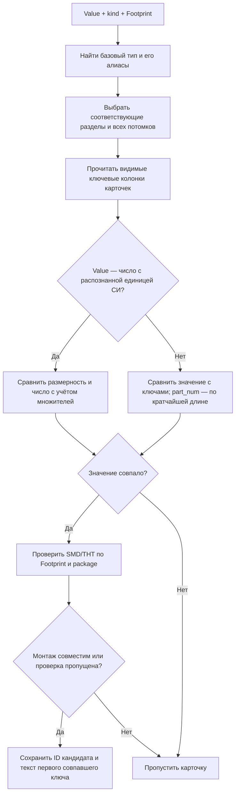

# Алгоритм сопоставления компонентов с каталогом: шаги и примеры

Актуальность: 21 ноября 2026 года. Документ описывает текущую реализацию
[ElPartsMatching.py](../ElPartsMatching.py), класс `PartsMatching`.
Все карточки и обозначения A–H в примерах условные. Личная база склада
для их подготовки не используется.

## 1. Что поступает на вход

Для одной позиции проекта нужны три поля:

| Поле проекта | Для чего используется | Пример |
|---|---|---|
| `Value`, в модели — `value_raw` | Искомое значение или модель | `100nF`, `AMS1117-3.3` |
| `kind` | Базовый тип и область поиска | `capacitor`, `ic` |
| `Footprint`, в модели — `footprint` | Проверка способа монтажа | `Capacitor_SMD:C_0805` |

Для входного словаря поддерживается имя `value`; если оно отсутствует,
используется `value_raw`. Отдельные поля `model` и `nominal` не подменяют Value.
Пустое Value сразу даёт пустой список кандидатов.

Из каталога читаются разделы, базовые типы и их алиасы, ключевые колонки,
единицы СИ, значения полей карточек и `package`. Поиск использует текущие
справочники БД, а не названия папок и не заранее составленный список деталей.

## 2. Общая последовательность



Эти проверки проходят все карточки выбранной области. Совпадение первой
карточки не останавливает поиск: возвращается полный список кандидатов.

## 3. Как выбираются разделы по Kind

Сначала `kind` сравнивается с именами `BASIC_TYPES`. Для сравнения имён
регистр, подчёркивания и разделяющие знаки нормализуются. Учитываются
настроенные ссылки `alias_of_id`.

Если прямого имени нет, используются стандартные соответствия, например:

| `kind` | Базовый тип каталога |
|---|---|
| `capacitor` | Capacitor |
| `resistor` | Resistor |
| `ic` | Integrated circuit |
| `connector` | Jack и Plug |
| `module` | Sub-assembly or module |
| `crystal` | Crystal or oscillator |
| `mounting_hole` | Hardware |

После определения типа выбираются соответствующие секции и все их потомки
рекурсивным CTE. Дочерняя секция участвует даже при другом собственном базовом
типе; её ключевые колонки при этом берутся из её эффективных настроек.

**Пример дерева:**

```text
Пассивные детали               базовый тип Capacitor
└── Керамические               базовый тип Capacitor
    └── Маленькие корпуса      базовый тип Miscellaneous

Конденсаторы для демонстрации  базовый тип Miscellaneous, отдельный корень
```

Для `kind=capacitor` поиск охватит первые три секции. Отдельный корень
«Конденсаторы для демонстрации» не включится только из-за своего названия.
Если соответствующего базового типа или алиаса нет, результат пустой;
поиск по всем разделам автоматически не включается.

## 4. Какие колонки считаются ключевыми

Используются поля, у которых эффективное значение `HEADERS.is_key` включено.
Настройки наследуются от предков; порядок берётся из `position`.
Скрытые колонки не участвуют, даже если помечены ключевыми.

Для числового сравнения видимая колонка `units` может предоставить единицу,
даже если она сама не выбрана ключевой. Видимый `package` используется
на последнем шаге для проверки монтажа. Скрытые `units` и `package`
не используются как вспомогательные сведения.

**Пример:** у секции ключи `device_code`, затем `part_num`.
В карточке:

```text
device_code = AMS1117-3.3
part_num    = Другая модель
description = Стабилизатор AMS1117-3.3
```

Value `AMS1117-3.3` совпадёт по `device_code`. Для отображения будет взято
`AMS1117-3.3`, а не `Другая модель`. Само по себе совпадение в `description`
не учитывается, если эта колонка не отмечена ключевой.

## 5. Ветка с единицами СИ

### 5.1. Распознавание Value

СИ-ветка применяется, когда всё Value разбирается как число и известная
завершающая единица либо единица с приставкой. Примеры: `100nF`, `4,7uF`,
`1kR`, `1K`, `1M`, `320uH`.

Единицы, множители и размерности берутся из `SI_UNITS`, дополнительные обозначения —
из `SI_UNIT_ALIASES`. Алиасы редактируются у нужной единицы в окне справочников;
например, `кОм` относится к Kiloohm. Изменение множителя единицы действует и на её
алиасы, повторного ввода множителя не требуется. Учитываются английские
и русские обозначения, точка и запятая, варианты `u`, `µ`, `μ`, а для
сопротивлений — записи вроде `R`, `Ω`, `k`, `K`, `M`.

Обе части сравнения единицы — суффикс Value и обозначения справочника —
переводятся в верхний регистр. Поэтому `кОм`, `КОМ` и `ком` распознаются одинаково.
Для сопротивлений поддержаны как краткие приставки, так и полные формы с `Ом`.

Регистр `m`/`M` при таком сравнении тоже не различается. Если верхний регистр
создаёт коллизию разных множителей, например `mR` и `MR`, алгоритм сохраняет
все интерпретации и возвращает все соответствующие карточки кандидатами.
Это не автоматический выбор милли- или мега-номинала; связь требует подтверждения.
Неизвестная единица не распознаётся как СИ, и применяется ветка полного значения.

### 5.2. Откуда берётся единица карточки

Для ключа карточки проверяются варианты:

1. В ключе записано число вместе с единицей: `0.1uF`.
2. В ключе записано число, а самостоятельная единица находится в другом ключе:
   `value=100`, `device_code=nF`, оба поля ключевые.
3. В ключе записано число, единица находится в видимом поле `units`:
   `value=100`, `units=нФ`.
4. Если отдельная единица не заполнена и не найдена в ключах, используется
   основная единица, привязанная к выбранному базовому типу.

Последний случай не означает угадывание приставки. Например, для Capacitor
основная единица — F. Число `0.0000001` без отдельной единицы можно сопоставить
с `100nF`, а число `100` без отдельной единицы означает 100 F, а не 100 nF.
Если `units` заполнено неизвестным текстом и нет подходящей единицы в ключах,
такая числовая карточка не получает размерность по умолчанию.

### 5.3. Число и размерность сравниваются отдельно

Условия совпадения:

```text
Основная единица проекта = основная единица карточки

Число проекта × множитель проекта = число карточки × множитель карточки
```

Сравнение выполняется через `Decimal`, без допуска «примерно равно».

Пример:

```text
100 nF = 100 × 0.000000001 F = 0.0000001 F
0.1 uF = 0.1 × 0.000001 F   = 0.0000001 F
```

Эти записи совпадают. То же исходное число с другой приставкой или
размерностью может не совпасть.

| Value проекта | Ключ карточки | Единица карточки | Результат по значению |
|---|---|---|---|
| `100nF` | `100` | `нФ` | Совпадает |
| `100nF` | `0.1uF` | Внутри ключа | Совпадает |
| `100nF` | `0.0000001` | Основная F, отдельная единица пуста | Совпадает |
| `100nF` | `100` | `мкФ` | Не совпадает: 100 uF вместо 100 nF |
| `100nF` | `100` | `V` | Не совпадает: другая размерность |
| `100nF` | `100` | Основная F, отдельная единица пуста | Не совпадает: 100 F |
| `1K` | `1000` | `Ом` | Совпадает: 1000 Ω |
| `1K` | `1` | `кОм` | Совпадает: 1000 Ω |
| `4.7K` | `4.7` | `КОМ` | Совпадает: 4700 Ω |
| `1mΩ` | `1` | `mR` | Совпадает; после верхнего регистра возможна коллизия милли/мега |
| `1M` | `1` | `M` | Совпадает: 1000000 Ω |
| `1mΩ` | `1` | `M` | Кандидат по мега-интерпретации верхнего регистра; нужно подтверждение |

Таблица предполагает правильный Kind и ещё не учитывает монтаж.

## 6. Ветка без распознанной единицы СИ

Value сравнивается с каждым видимым ключом. Исключение для `part_num`: сравнение
по длине кратчайшей непустой строки (лишний хвост игнорируется).
Например, `AMS1117` ↔ `AMS1117-3.3` и `AMS1117-3.3-extra` ↔ `AMS1117-3.3` совпадают.
Остальные ключи сравниваются целиком:

- пробелы по краям убираются;
- регистр текстового значения игнорируется;
- подстроки не ищутся;
- полностью числовые записи сравниваются как числа с точкой или запятой.

| Value проекта | Значение ключа | Результат по значению |
|---|---|---|
| `AMS1117-3.3` | `AMS1117-3.3` | Совпадает |
| ` ams1117-3.3 ` | `AMS1117-3.3` | Совпадает |
| `AMS1117-3.3` | `AMS1117-3.3-extra` | Совпадает только для part_num |
| `BP2525F` | `BP2525F` | Совпадает: это модель, а не число с F |
| `0,3` | Число `0.3` | Совпадает |
| `4k7` | `4k7` | Совпадает как полная строка |
| `4k7` | `4700` | Не совпадает: сопоставление не разбирает RKM-запись |

В этой ветке отдельная проверка единицы не выполняется. Нормализованный
`nominal`, который мог вернуть импортёр, не используется вместо Value.
Проверка Kind и финальная проверка монтажа остаются обязательными.

## 7. Финальная проверка SMD/THT

Правило одинаково для `Footprint` проекта и `package` каталога:

1. Если текст содержит явное SMD или THT, используется указанное значение.
   Для THT также распознаются записи ТНТ и TNT.
2. Если текст заполнен, но этих обозначений нет, принимается SMD.
3. Если `package` пустой, сравнение монтажа пропускается.
4. Если `Footprint` пустой, ограничения со стороны проекта нет.

| Footprint проекта | package каталога | Результат монтажа |
|---|---|---|
| `Capacitor_SMD:C_0805` | `SMD 0805` | Совместим |
| `Capacitor_SMD:C_0805` | `0805` | Совместим: package считается SMD |
| `Package_SOT:SOT-23` | `SOT-23` | Совместим: оба текста считаются SMD |
| `Capacitor_THT:CP_Radial` | `THT` | Совместим |
| `Capacitor_THT:CP_Radial` | `0805` | Не совместим: THT против SMD |
| `Capacitor_SMD:C_0805` | `ТНТ DIP-8` | Не совместим |
| `Package_DIP:DIP-8` | `SMD` | Совместим по правилу: Footprint без метки считается SMD |
| `Capacitor_THT:CP_Radial` | Пусто | Проверка пропущена |
| Пусто | `THT` | Проверка пропущена |

Геометрия корпуса не анализируется. Если нужно обозначить THT, он должен быть
явно указан в строке. Если строка содержит оба обозначения, она допускает оба
способа монтажа; достаточно общего способа с другой стороной.

## 8. Полный пример: C1 = 100nF

Позиция проекта:

```json
{
  "reference": "C1",
  "kind": "capacitor",
  "value_raw": "100nF",
  "footprint": "Capacitor_SMD:C_0805"
}
```

В каталоге есть следующие условные карточки. В нужных секциях ключевой
колонкой выбрана `value`, а `units` и `package` видимы.

| Карточка | Область | value | units | package | Решение |
|---|---|---|---|---|---|
| A | Capacitor | `100` | `нФ` | `0805` | Найдена: значение и SMD совпали |
| B | Дочерний раздел Capacitor | `0.1uF` | Пусто | `SMD` | Найдена: эквивалентный номинал |
| C | Capacitor | `100` | `мкФ` | `SMD` | Отклонена: другой номинал |
| D | Capacitor | `100` | `V` | `SMD` | Отклонена: другая размерность |
| E | Capacitor | `100nF` | Пусто | `THT` | Отклонена: другой монтаж |
| F | Capacitor | `100` | `нФ` | Пусто | Найдена: проверка монтажа пропущена |
| G | Отдельный Resistor | `100nF` | Пусто | `SMD` | Не рассматривается: вне области Kind |
| H | Capacitor | `47nF` | Пусто | `SMD` | Отклонена; наличие `100nF` в неключевом description не помогает |

Итог — A, B и F, отсортированные по внутренним ID каталога. Если A имеет
наименьший ID, её первое совпавшее ключевое значение будет показано в подсказке кнопки
`YES` в `prj_parts_all`: для числового поля SQLite это может быть строка `100.0`.

Совпадение не ограничено только карточками с `present=1`. Количество, цена,
остатки, DNP и включение в BOM не являются дополнительными фильтрами этого
алгоритма. Поиск устанавливает соответствие карточкам, а не достаточность запасов.

## 9. Полный пример: U3 = AMS1117-3.3

Позиция имеет `kind=ic`, Value `AMS1117-3.3` и Footprint
`Package_SOT:SOT-223`. Выбираются секции Integrated circuit и их потомки.
Это ветка полного значения: Value не начинается с числа, представляющего
всё значение с единицей СИ.

Ключи секции упорядочены: сначала `device_code`, затем `part_num`.

| Карточка | device_code | part_num | package | Решение |
|---|---|---|---|---|
| A | `AMS1117-3.3` | `Другая модель` | `SOT-223` | Найдена по device_code; монтаж считается SMD |
| B | Пусто | `ams1117-3.3` | `SMD` | Найдена по part_num |
| C | Пусто | `AMS1117-3.3-extra` | `SMD` | Найдена по part_num: совпадает кратчайшая строка |
| D | Пусто | `AMS1117-3.3` | `THT` | Отклонена после совпадения текста: другой монтаж |

Для A отображается `AMS1117-3.3` из `device_code`; для B — её собственный
текст `ams1117-3.3` из `part_num`. Регистр исходного текста карточки
в отображении сохраняется.

## 10. Что сохраняется и что видит пользователь

Для каждого кандидата создаётся `CatalogMatch`:

| Поле результата | Содержание |
|---|---|
| `part_id` | Ссылка на карточку каталога |
| `type_id` | Ссылка на её раздел |
| `key_text` | Текст первой совпавшей ключевой колонки |
| `matched_fields` | Имена всех совпавших ключевых колонок в их порядке |

Идентификаторы нужны для операций, но не показываются в интерфейсе.
ID позиции хранится в `Qt.UserRole`, все ID найденных карточек — в
`MATCHING_CANDIDATES_ROLE`. Полные результаты находятся в
`ProjWindow.matchingCandidates` по ID позиции проекта.

В таблицах `prj_parts_all` и `no_matched_tbl` колонка **Статус сопоставления**
показывает кнопку `YES` зелёным текстом при наличии кандидатов или подтверждённой
связи, иначе — `NO` красным текстом. `no_matched_tbl` содержит только строки `NO`.
Подсказка кнопки показывает `key_text` подтверждённой карточки, а при отсутствии
связи — первого кандидата. Значение сохранено в `MATCHING_LABEL_ROLE`.
Нажатие выдаёт сигнал `matchingRequested(component_id)` для будущей формы.

Кандидаты хранятся в памяти модели и пересчитываются только при нажатии
Link Part; окно ElLogWnd показывает прогресс и результат для каждой группы. Автоматический поиск и нажатие кнопки не создают строки
`PROJECT_COMPONENT_MATCHES`.

При ручном подтверждении отдельно сохраняется связь позиции с `PARTS.id`.
Поиск не меняет карточки каталога, остатки и ранее подтверждённые связи.

## 11. Где реализованы этапы

| Этап | Файл |
|---|---|
| Нормализация Value, Kind, СИ и монтажа; поиск кандидатов | [ElPartsMatching.py](../ElPartsMatching.py) |
| Константы сопоставления и скрытая роль модели | [ElConstants.py](../ElConstants.py) |
| Структура результата и доступ к данным каталога | [ElData/ElDBDataParts.py](../ElData/ElDBDataParts.py) |
| SQL выбора секций, потомков и карточек | [ElData/ElDBScheme.py](../ElData/ElDBScheme.py) |
| Получение справочников единиц и типов | [ElData/ElDBDataUnits.py](../ElData/ElDBDataUnits.py) |
| Вывод ключей и хранение ссылок в таблицах проекта | [ElProjWindow.py](../ElProjWindow.py) |
| Проверки на временных каталогах | [tests/test_parts_matching.py](../tests/test_parts_matching.py) |

Краткий технический контракт: [Сопоставление компонентов с каталогом](parts-matching.md).
